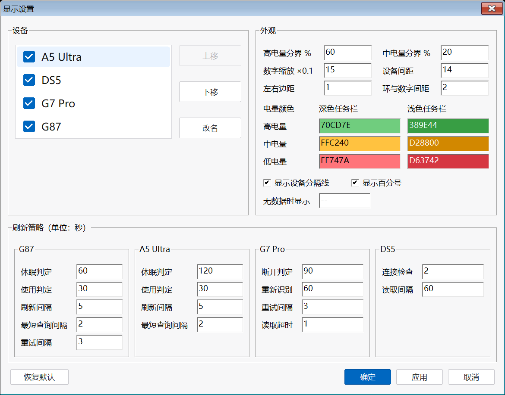

# PeripheralBattery

[TrafficMonitor](https://github.com/zhongyang219/TrafficMonitor) 外设电量插件：在任务栏显示键盘、鼠标、手柄的电量。


## 支持设备

| 设备 | 连接方式 | 通道 | 电量来源 |
| --- | --- | --- | --- |
| 迈从（MCHOSE）G87 2.4G 键盘 | USB 接收器 | HID（VID\_41E4），0x13 协议帧 | 查询响应 `[5]=电量`，`[6]&0x10=充电` |
| 迈从（MCHOSE）A5 Ultra 2.4G 鼠标 | USB 接收器 | HID（VID\_3837 / PID\_100C，UsagePage 0xFF01） | `SetFeature(11 06)` 请求 → `GetFeature(0x11)` 读响应 `[11]=电量`，`[12]=充电` |
| 盖世小鸡（GameSir）G7 Pro 2.4G 手柄 | USB 接收器 | `\\.\XboxGIP` 总线只读旁观 | 设备主动上报的 Status 消息，低 2 位为 0~3 档（0/33/66/100%），bit4 充电 |
| PS5 DualSense 手柄 | 经 [DS5Dongle](https://github.com/awalol/DS5Dongle) 桥接为 USB | USB HID（VID\_054C / PID\_0CE6） | Input Report 0x01 byte[53]：低 4 位档位 0~10（`min(档位×10+5,100)`），高 4 位充电状态 |

## 显示效果

每台设备显示为「名称 + 电量圆环」，设备之间用分隔线隔开。

- 圆环按电量比例描弧，数字在环内
- 配色：≥60% 绿、20%~59% 黄、<20% 红，阈值与颜色可在设置中修改
- 充电中环内显示 ⚡
- 未连接或无读数：不画圆环，名称与 `--` 置灰
- 跟随任务栏深浅色与字体缩放
- 悬停显示型号、电量与更新时间


## 显示设置，可自定义参数



## 刷新策略

原则：不主动唤醒设备。

- **键盘 / 鼠标**：不轮询；唤醒时查询一次，使用中每 5 秒刷新，闲置即停并保留最后读数
- **G7 Pro**：只读监听总线消息，90 秒无消息视为断开
- **DualSense**：每 2 秒本地枚举检查在位，在位时每 60 秒读一次

间隔可在显示设置的「刷新策略」中调整。查询时临时打开句柄、读完即关，不影响设备休眠，也不与官方驱动冲突。

## 安装

1. 从 [Release](../../releases) 下载 `PeripheralBattery.dll`
2. 复制到 TrafficMonitor 的 `plugins` 目录
3. 重启 TrafficMonitor，在 **选项设置 → 任务栏 → 显示设置** 中勾选「外设电量显示」

## 编译

需要 Visual Studio（"使用 C++ 的桌面开发"工作负载）和 Windows SDK，然后运行：

```
build.bat
```

输出 `out\PeripheralBattery.dll`。

## 目录结构

```
src/
  common/                公共头文件（插件接口、HID、电池数据）
  keyboard/              G87 键盘协议与后台线程
  mouse/                 A5 Ultra 协议与后台线程
  dualsense/             DualSense 协议与后台线程
  g7/                    G7 Pro GIP 监听与后台线程
  plugin/                插件主类、显示项、绘制与设置对话框
    BatteryDraw.h        电量圆环绘制与布局
    PluginConfig.*       可调参数与 ini 读写
    PeripheralItem.*     显示项（自绘）
    Plugin.*             插件主类与显示设置对话框
docs/                    截图
build.bat                编译脚本
```

每台设备由 `XxxDevice`（协议）与 `XxxReader`（后台线程）组成，线程通过快照向界面供数；绘制集中在 `BatteryDraw.h`。

## 已知限制

- G7 Pro 只能读到 4 档电量（0/33/66/100%），精确百分比为 GameSir 私有协议
- DualSense 需经 DS5Dongle 桥接为 USB，蓝牙直连不支持

## License

MIT
