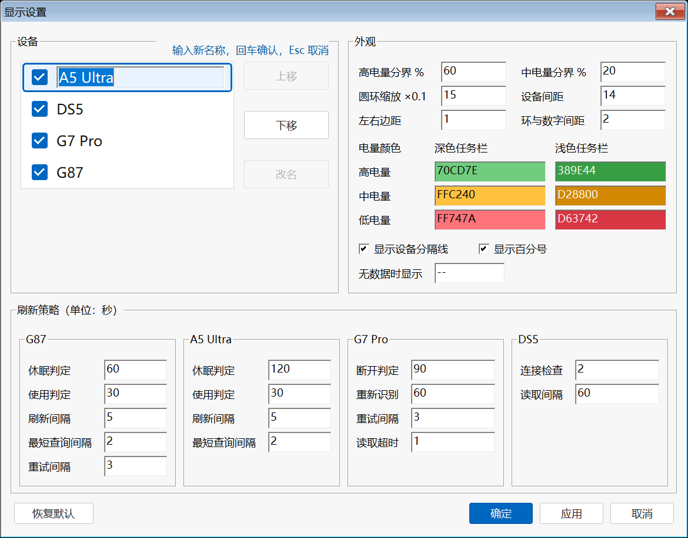
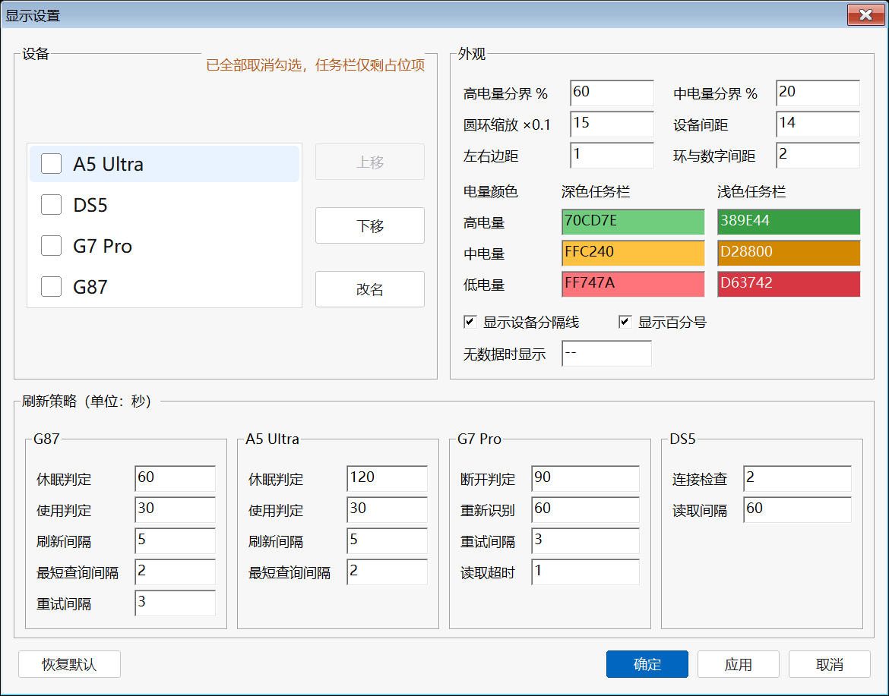

# PeripheralBattery

[TrafficMonitor](https://github.com/zhongyang219/TrafficMonitor) 外设电量显示插件 —— 在任务栏一眼看清键盘、鼠标、手柄的电量。


## 支持设备

| 设备 | 连接方式 |
| --- | --- |
| 迈从（MCHOSE）G87 2.4G 键盘 | USB 接收器 |
| 迈从（MCHOSE）A5 Ultra 2.4G 鼠标 | USB 接收器 |
| 盖世小鸡（GameSir）G7 Pro 2.4G 手柄 | USB 接收器 |
| PS5 DualSense 手柄 | 经 [DS5Dongle](https://github.com/awalol/DS5Dongle) 桥接为 USB |

## 显示效果

任务栏为每个设备绘制一段「名称: 电量数字内嵌的圆环」，设备间用短弱化分隔线：

- **电量配色分级**：≥60% 绿色 / 20~59% 黄色 / <20% 红色（阈值与配色可在「显示设置 → 外观」中调整），一眼识别电量状态
- **充电指示**：充电中圆环内改画 ⚡（不显示数字，颜色跟随电量色）
- **状态区分**：
  - 正常：圆环按电量比例描弧，电量数字（无百分号）以电量色显示在环内
  - 暂无读数 / 未连接（含手柄关机/断开）：不画圆环，设备名与 `--` 一起弱化，所有设备一致
- **自绘适配**：圆环尺寸随任务栏字体缩放（DPI 自适应），文字绘制与 TrafficMonitor 自带条目同一基线，深浅色任务栏自动适配
- **悬停详情**：鼠标悬停查看每设备一行式详情「图标 型号：电量 · 更新时间」，充电时带 ⚡充电中

各状态效果（上：常规；中：边界状态；下：任务栏实际高度）：


## 显示设置

插件自带 Win11 风格的选项对话框（插件管理 → 选项设置）：

- **设备**：白色复选列表，每台设备一行——点勾选框决定是否显示（未勾选不轮询；全部取消勾选时任务栏保留一个「外设电量」占位项，仍可右键打开设置勾回来，此时分组标题右侧会提示「已全部取消勾选，任务栏仅剩占位项」）；选中一行后用右侧「上移 / 下移」调整显示顺序，「改名」会在该行就地编辑显示名。「设备」与右侧「外观」各占一半宽度、左右并列，两组等高
- 底部左侧「恢复默认」一键还原显示顺序、勾选与全部参数（点「确定 / 应用」后才写入）
- **刷新策略**：每个设备单独一块，卡片标题就是该设备的显示名（随「设备」里的改名实时变化），块内只列该设备自己的参数（单位：秒）
- **外观**：顶部是数值参数，2 列 3 行——高 / 中电量分界、数字缩放（×0.1）、设备间距、左右边距、环与数字间距；下面「电量颜色」高 / 中 / 低三行，深色任务栏与浅色任务栏各一列，共 6 个颜色（6 位 RGB 十六进制，如 `70CD7E`；输入框直接以该颜色作背景，改完即见效果）；再往下是显示开关（设备分隔线、百分号）与无数据时显示的文字（默认 `--`）
- 「应用」按钮即时预览，「确定」持久化写入 `PeripheralBattery.ini`（`[Options]` 与 `[Advanced]` 段）；非法输入会提示且不会保存


刷新策略和外观数值参数都带悬停说明：鼠标停上去即显示该参数的具体含义（如「休眠判定」= 闲置满这么多秒后的第一次按键算唤醒并立即查询一次），不必去翻文档。设备区与电量配色一目了然，不挂提示。


点「改名」进入就地编辑时，选中行会加主题蓝描边、输入框变浅蓝，分组标题右侧提示「输入新名称，回车确认，Esc 取消」，「改名」按钮同时置灰——一眼就能看出正处在改名状态：



四台设备全部取消勾选时，设备分组标题右侧会给出提示（此时任务栏只剩占位项，右键它即可重新打开设置）：



配置以 UTF-16（带 BOM）保存，用记事本 / VS Code 直接打开中文不会乱码；旧版本留下的 ANSI 配置会在首次启动时自动转换。外观与文案立即生效，刷新间隔在该设备下一次循环时生效。

## 各设备读取方式

| 设备 | 通道 | 电量来源 |
| --- | --- | --- |
| G87 键盘 | HID（VID\_41E4），0x13 协议帧 | 查询响应 `[5]=电量`，`[6]&0x10=充电` |
| A5 Ultra 鼠标 | HID（VID\_3837 / PID\_100C，UsagePage 0xFF01） | `SetFeature(11 06)` 请求 → `GetFeature(0x11)` 读响应 `[11]=电量`，`[12]=充电` |
| G7 Pro 手柄 | `\\.\XboxGIP` 总线只读旁观 | 设备主动上报的 Status 消息，低 2 位为 0~3 档（0/33/66/100%），bit4 充电 |
| DualSense | USB HID（VID\_054C / PID\_0CE6） | Input Report 0x01 byte[53]：低 4 位档位 0~10（`min(档位×10+5,100)`），高 4 位充电状态 |

## 刷新策略

以"不吵醒设备"为第一原则，各设备策略不同：

- **键盘 / 鼠标**：无周期轮询。唤醒瞬间查一次；使用中（30 秒内有按键/移动）每 5 秒刷新；闲置即停，设备自然休眠；休眠时保持最后读数
- **G7 Pro**：纯被动监听总线消息，不发送任何请求；90 秒无消息视为断开，环内显示 `--`
- **DualSense**：每 2 秒做一次本地 PnP 枚举检测在位（零 USB 请求）；在位时每 60 秒被动读一次，断开显示 `--`

以上间隔均可在「显示设置」的刷新策略中调整：该区按设备分成四块，每块标题为设备当前显示名（改名后立即同步），块内是该设备独有的参数。

查询时临时打开设备句柄、读完立即关闭（即查即关）：不影响设备休眠，不与官方驱动 / 网页驱动争用配置会话，无需关闭本插件即可正常使用官方软件。

## 安装

1. 从 [Release](../../releases) 下载 `PeripheralBattery.dll`
2. 复制到 TrafficMonitor 的 `plugins` 目录
3. 重启 TrafficMonitor，在 **选项设置 → 任务栏 → 显示设置** 中勾选「外设电量显示」

## 编译

需要 Visual Studio（"使用 C++ 的桌面开发"工作负载）和 Windows SDK，然后运行：

```
build.bat
```

输出 `out\PeripheralBattery.dll`。

## 目录结构

```
src/
  common/                公共头文件（PluginInterface.h / HidApi.h / BatteryCommon.h）
  keyboard/              G87 键盘协议层与后台线程
  mouse/                 A5 Ultra 协议层与后台线程
  dualsense/             DualSense 协议层与后台线程
  g7/                    G7 Pro GIP 监听与后台线程
  plugin/                插件主类、显示项与任务栏绘制
    BatteryDraw.h        任务栏电量圆环绘制与布局（GDI + GDI+，独立无依赖）
    PluginConfig.*       可调参数（刷新策略 / 外观 / 文案）与 ini [Advanced] 读写
    Plugin.*             插件主类（ITMPlugin）、显示设置对话框
    PeripheralItem.*     显示项（IPluginItem 自绘）
    dllmain.cpp          DLL 入口
docs/                    说明文档截图
build.bat                一键编译脚本
tools/                   开发用逆向/预览工具（不参与编译，gitignore）
```

架构说明：每个设备一对 `XxxDevice`（协议）+ `XxxReader`（后台线程），通过 mutex 保护的快照向 UI 供数；线程即查即关句柄、可被 Stop 打断；任务栏绘制集中在 `BatteryDraw.h`，与插件逻辑解耦。

## 已知限制

- G7 Pro 系统层只能读到 4 档电量（0/33/66/100%），精确百分比是 GameSir 私有协议（Nexus 专有），系统层不可获得
- DualSense 需经 DS5Dongle 桥接为 USB 形态；蓝牙直连读不到


## License

MIT
